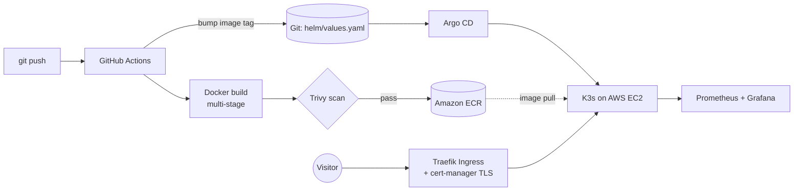

# rizky-portfolio

My personal portfolio site, built as a hands-on DevOps project. The site is a single static page. The interesting part is how it ships: a GitOps pipeline that takes every commit through build, security scan, container registry, and Kubernetes on AWS, with HTTPS and monitoring.

## Architecture



1. A push to `main` starts the GitHub Actions workflow.
2. The image is built in two stages: minify the HTML, then serve it with unprivileged Nginx.
3. Trivy scans the image. HIGH or CRITICAL findings with a fix available fail the build.
4. The image is pushed to Amazon ECR, tagged with the commit hash. GitHub gets AWS access through OIDC, so there are no stored AWS keys.
5. The workflow commits the new tag to `helm/portfolio/values.yaml`.
6. Argo CD sees the commit and syncs the Helm chart to the K3s cluster. Rollback is a `git revert`.
7. Traefik routes traffic and cert-manager issues the Let's Encrypt certificate.

## Stack

| Area | Tools |
| --- | --- |
| Cloud | AWS EC2, ECR, IAM (OIDC), Elastic IP |
| Cluster | K3s, Helm, Traefik Ingress, cert-manager |
| Delivery | GitHub Actions, Argo CD (GitOps), Docker |
| Security | Trivy, non-root container, read-only root filesystem, dropped capabilities, CSP and security headers |
| Observability | Prometheus, Grafana (kube-prometheus-stack) |

## Repository layout

```
site/                    the portfolio page (single HTML file)
Dockerfile, nginx.conf   multi-stage build and hardened Nginx config
.github/workflows/       CI: build, scan, push, bump tag
helm/portfolio/          Helm chart (Deployment, Service, Ingress)
argocd/                  Argo CD install values and the Application
k8s/                     cert-manager ClusterIssuers
aws/                     IAM and ECR policy files used in the tutorial
monitoring/              kube-prometheus-stack values for a small node
docs/TUTORIAL.md         step-by-step deployment guide (Bahasa Indonesia)
```

## Run it locally

```bash
docker build -t rizky-portfolio .
docker run --rm -p 8080:8080 rizky-portfolio
# open http://localhost:8080
```

## Deploy it yourself

Follow [docs/TUTORIAL.md](docs/TUTORIAL.md). It covers the AWS setup, K3s, cert-manager, Argo CD, the GitHub Actions variables, monitoring, rollback, and cleanup.

## Design notes

- **Traefik instead of ingress-nginx.** The Kubernetes project retired ingress-nginx in March 2026, so it no longer gets security fixes. K3s already ships Traefik, which also saves memory on a small node. Nginx is still used inside the container to serve the page.
- **K3s on EC2 instead of EKS.** EKS charges for the control plane by the hour. K3s runs the same Kubernetes API on one small instance.
- **GitOps over `kubectl apply` in CI.** The cluster pulls its desired state from Git, so CI never needs cluster credentials.

## License

MIT for the code in this repository. The site content (text) is personal.
